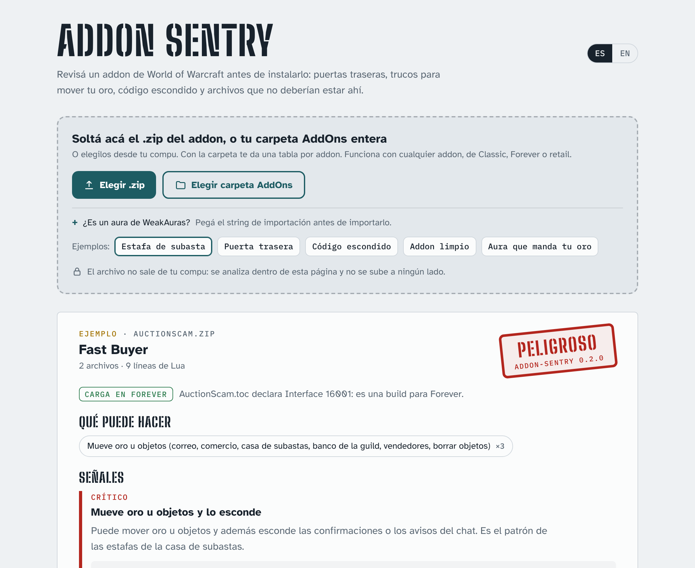

# Addon Sentry

Check a World of Warcraft addon **before you install it**. It reads the addon's Lua code without running it and warns about backdoors, tricks that move your gold, hidden code and files that should not be there.

[Leer en castellano](README.md)

**Use it here, nothing to install:** https://joseargento.github.io/addon-sentry/

- **Web page** (`dist/index.html`, one file): drop the zip, it is checked inside the browser and never uploaded.
- **Command line**: `pip install addon-sentry`, then `addon-sentry file.zip` or `addon-sentry folder/` (`--lang en`, `--format json`, `--fail-on high`).

**Does it load in Forever?** The most common launch-day problem on WoW Forever is installing the wrong build: Classic Era files do not load there, and some addons ship a separate "Forever" file that addon managers overwrite with "latest". Under the verdict, every report says what the `.toc` declares: **Loads in Forever** (the TOC Forever picks, `Addon_Camelot.toc` / `_Forever` / `_Mainline` / `Addon.toc`, declares Interface 1.60.x), **Not a Forever build** (names the version it is for: Classic Era, TBC Classic, retail...), **Forever will not list it** (no TOC named after the folder, the GitHub-zip case, with the folder name to use), **Excludes Forever on purpose** (`AllowLoadGameType`/`ExcludeLoadGameType`) or **No Interface version**. Informational only: it never changes the security verdict.

**A whole AddOns folder:** give it a folder with several addons (your `Interface\AddOns`, or a zip that holds several) and you get **one verdict per addon** in a table (addon, version, verdict, Forever, what it can do), then the details of each. The top verdict is the worst of the set, and multi-file signals never mix across addons. On the page: "Choose AddOns folder", or drop the folder onto the page; it is read in the browser and never uploaded. Files outside every addon folder show up as "(loose files)".

**WeakAuras strings** too: paste an import string in the page, or run `addon-sentry --aura aura.txt` (`-` reads standard input). It decodes all three formats WeakAuras imports (`!WA:2!`, the 2019-2020 `!` format and the pre-2018 LibCompress one) without importing or running anything, scans every field WeakAuras compiles into a function, counts automatic chat actions as "sends messages", and flags code that uses what WeakAuras blocks (`SendMail`, `RunScript`, `getfenv`, ...). The decoders are checked table by table against the real Lua libraries, and on 135 public pre-2018 strings.

It separates what an addon **can do** (many legitimate addons move gold or send messages) from **warning signs**: code that runs messages from other players, obfuscated code that gets run, Blizzard money/confirmation functions replaced while moving gold, sensitive function names built piece by piece, executables, zip-slip paths, guild disbanding, collecting other players' statistics.

Only code the game loads counts (files listed by `.toc`/`.xml`, including inline XML scripts). The scanner ignores "ignore" comments inside the code it scans. The Python and JavaScript engines are checked against each other on the same zips, including eight popular addons, and the page is tested in Chromium (zip, multi-addon zip, folder, both languages, phone width). ⏳ Not yet tried on zips downloaded from CurseForge or on a real client `AddOns` folder: only repos and fixtures.

It is an automatic pattern check: it cannot prove an addon is safe, and a warning is not proof of bad intent. Not affiliated with Blizzard Entertainment. MIT license.

## Support

All of this is free and open source, and it stays that way: no paid features, nothing early for supporters. If it helped you and you want to cover the time it takes to keep it working (every Blizzard patch means refreshing the data and fixing what broke), you can do that on [Patreon](https://www.patreon.com/cw/DoblePupi). Thanks ♥
