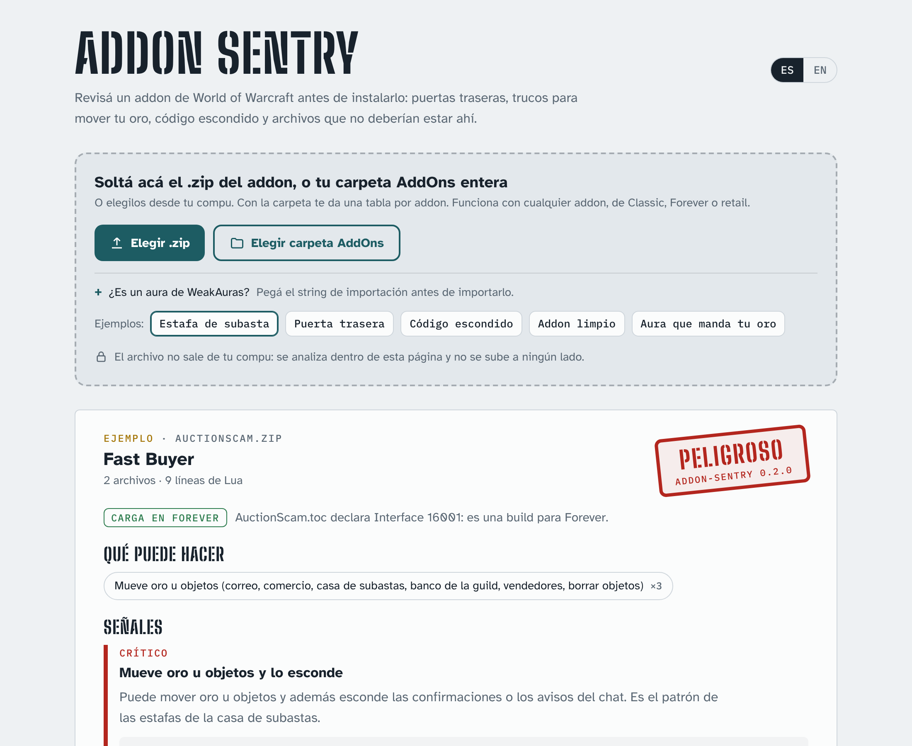

# Addon Sentry

Revisá un addon de World of Warcraft **antes de instalarlo**. Lee el código Lua sin ejecutarlo y avisa si encuentra puertas traseras, trucos para mover tu oro, código escondido o archivos que no deberían estar ahí.

[Read in English](README.en.md)



**Usalo acá, sin instalar nada:** https://joseargento.github.io/addon-sentry/

**Contenido**

- [¿Carga en Forever?](#carga-en-forever)
- [Toda la carpeta AddOns](#toda-la-carpeta-addons)
- [Auras de WeakAuras](#auras-de-weakauras)
- [Qué busca](#qué-busca)
- [Cómo se probó](#cómo-se-probó)
- [Límites](#límites)
- [Desarrollo](#desarrollo)
- [Apoyar](#apoyar)

```
$ addon-sentry FastBuyer.zip
addon-sentry 0.2.0 · FastBuyer.zip

 PELIGROSO
  Carga en Forever  FastBuyer.toc declara Interface 16001: es una build para Forever.

Qué puede hacer
  • Mueve oro u objetos (correo, comercio, casa de subastas, ...)

Señales
  CRÍTICO Mueve oro u objetos y lo esconde
    AuctionScam/Scam.lua:2  C_AuctionHouse.ConfirmCommoditiesPurchase = function(itemID, quantity)
```

Hay dos formas de usarlo, con el mismo motor:
- **La página web** (`dist/index.html`, un solo archivo): soltás el zip y se analiza en el navegador, sin subir nada.
- **La línea de comandos**: `pip install addon-sentry`, y después `addon-sentry archivo.zip` o `addon-sentry carpeta/`. Tiene opciones `--lang es|en`, `--format json` y `--fail-on high`.

## ¿Carga en Forever?

El problema más común del lanzamiento de WoW Forever no es un addon malicioso: es instalar la build equivocada. Los archivos de Classic Era no cargan en Forever, y algunos addons tienen un archivo aparte marcado "Forever" que el gestor de addons pisa con "latest". Cada reporte dice, debajo del veredicto, qué encontró en el `.toc`:

| Dice | Qué significa |
|---|---|
| **Carga en Forever** | El TOC que Forever elige (`Addon_Camelot.toc`, `Addon_Forever.toc`, `Addon_Mainline.toc` o `Addon.toc`, en ese orden) declara `Interface 16001` (o cualquier 1.60.x). |
| **No es una build de Forever** | Declara otra versión (dice cuál: Classic Era, TBC Classic, retail…). Forever lo marca como desactualizado y, aunque lo cargues igual, va a fallar donde use API que Forever no tiene. |
| **Forever no lo va a listar** | No hay un TOC con el nombre de la carpeta. Es lo que pasa con los zips de GitHub (`Questie-12.4.0/`): te dice cómo tiene que llamarse la carpeta. |
| **Excluye a Forever a propósito** | El TOC lo deja afuera con `AllowLoadGameType`/`ExcludeLoadGameType` (por ejemplo, un módulo de DBM solo para retail). |
| **Sin versión de interfaz** | El TOC no tiene `## Interface`. |

Es informativo: nunca cambia el veredicto de seguridad. Las claves por versión (`## Interface-Forever`, `## Interface-Camelot`, `## Interface-Mainline`) pesan más que `## Interface`.

## Toda la carpeta AddOns

Si le das una carpeta con varios addons (tu `Interface\AddOns` entera, o un zip que trae varios), hace **un veredicto por addon** y arma una tabla: addon, versión, veredicto, si carga en Forever y qué puede hacer. Abajo va el detalle de cada uno. El veredicto de arriba es el peor del conjunto, y las señales que combinan varios archivos (uno escucha, otro ejecuta) no se mezclan entre addons distintos.

- En la terminal: `addon-sentry "C:\World of Warcraft\_forever_\Interface\AddOns"`.
- En la página: "Elegir carpeta AddOns", o soltá la carpeta sobre la página. Se lee en el navegador; nada se sube.

Los archivos que quedan fuera de toda carpeta de addon aparecen como "(archivos sueltos)". Las bibliotecas embebidas (`Libs/`) cuentan como parte del addon que las trae.

## Auras de WeakAuras

Un aura es código que alguien te pasa como texto (`!WA:2!...`), y es una vía de estafa conocida. Addon Sentry lo lee **sin importarlo**: pegás el string en la página, o en la terminal:

```
addon-sentry --aura aura.txt        # o: pbpaste | addon-sentry --aura -
```

- Decodifica los tres formatos que importa WeakAuras: el actual (`!WA:2!`, LibDeflate + LibSerialize), el de 2019-2020 (`!`, LibDeflate + AceSerializer) y el anterior a 2018 (sin `!`, LibCompress + AceSerializer). Los decodificadores están escritos de nuevo a partir de esas librerías; nada se ejecuta.
- Revisa cada campo que WeakAuras convierte en función (disparadores, textos, acciones, animaciones, condiciones, grupos dinámicos), y además cualquier campo con nombre de código que parezca Lua, por si una versión nueva agrega uno.
- Las acciones de chat sin código (por ejemplo un susurro automático a un nombre fijo) cuentan como "manda mensajes".
- Señal propia: **usa cosas que WeakAuras bloquea** (`SendMail`, `SetTradeMoney`, `RunScript`, `getfenv`, `DEFAULT_CHAT_FRAME`, ... la lista de `AuraEnvironment.lua`). WeakAuras ya las anula, pero un aura normal no las necesita.
- Avisa si el string es de Plater, ElvUI o MDT: esos todavía no los lee.

## Qué busca

Separa lo que un addon **puede hacer** de las **señales de riesgo**. Muchos addons legítimos mueven oro (los de correo), mandan mensajes (los de raid) o ejecutan código del usuario (WeakAuras). Eso aparece en "Qué puede hacer" y no sube el veredicto.

| Veredicto | Cuándo |
|---|---|
| **Peligroso** | Ejecuta código que mandan otros jugadores (`CHAT_MSG_ADDON` + `loadstring`); código ofuscado que se ejecuta; mueve oro y reemplaza funciones de Blizzard para mentir sobre precios u oro; ejecutables; rutas que escapan de la carpeta (*zip slip*). |
| **Sospechoso** | Reemplaza funciones sensibles de Blizzard; arma de a pedazos nombres como `"Send".."Mail"`, `("liaMdneS"):reverse()` o `string.char(...)`; puede disolver la guild. |
| **Revisar** | Código ofuscado; mueve oro y además filtra el chat o acepta ventanas solo; junta estadísticas de otros jugadores y las guarda; archivos con contraseña o comprimidos adentro. |

Detalles que evitan falsos positivos:
- Solo cuenta el código que el juego **carga**, es decir, lo que listan los `.toc` y `.xml`, incluidos los scripts dentro de los XML.
- Distingue locales de funciones de Blizzard.
- Reconoce los polyfills y las plantillas de código, como el `loadstring` de CallbackHandler.
- En una carpeta de código fuente respeta el `ignore:` de `.pkgmeta`.
- **No respeta** comentarios de "ignorar" dentro del código que analiza, porque un autor malicioso los usaría.

## Cómo se probó

- **Calibración:** Questie, Details!, Bartender4, BigWigs, Deadly Boss Mods, ElvUI, WeakAuras y Plater dan "Sin señales de riesgo". En la carpeta de desarrollo de Questie aparece el `.exe` que tiene en `ExternalScripts(DONOTINCLUDEINRELEASE)`, que no va en la descarga.
- **Detección:** 8 addons de prueba con los patrones reales dan el veredicto esperado: puerta trasera por mensajes de addon, puerta trasera escondida en un `<OnEvent>` del XML, estafa de subasta, cargador ofuscado, nombres armados, disolver la guild, perfilador y addon limpio.
- **Forever y carpetas:** fixtures con una build solo de Classic (`Interface 11509`), una con `## Interface-Forever` y una carpeta `AddOns` con cuatro addons mezclados (uno peligroso, uno viejo, uno con la carpeta mal nombrada) más archivos sueltos. Sobre los 8 addons reales el veredicto no cambió; la columna Forever coincide con lo que se sabe de ellos (Questie tiene `Questie_Camelot.toc`, WeakAuras no tiene TOC para Forever, los módulos de DBM de Midnight excluyen a Forever). ⏳ Falta probar con zips bajados de CurseForge y con una carpeta `AddOns` real del cliente: solo con repos y fixtures.
- **Página:** `tests/test_page.py` abre `dist/index.html` en Chromium (Playwright): un zip, un zip con varios addons, la carpeta, los dos idiomas, un celular de 375 px y ningún error de consola.
- **Paridad:** `tests/test_parity.py` corre el motor de Python y el de JavaScript sobre los mismos zips, incluidos los 8 addons reales (más de 200 mil líneas de Lua), y exige reportes idénticos en los dos idiomas. También sobre strings de auras, rotos incluidos.
- **Auras:** los strings de prueba los generan las librerías reales en Lua 5.1 (`tools/make_aura_fixtures.py`, con [lupa](https://pypi.org/project/lupa/)), y un test compara tabla por tabla lo que decodifica Addon Sentry con lo que decodifican LibDeflate, LibSerialize, AceSerializer y LibCompress. Se probó también con 135 strings públicos de un pack de UI viejo (2.024 auras, formato anterior a 2018): todos decodifican igual que con las librerías reales y dan "Sin señales de riesgo".

## Límites

Es un chequeo automático de patrones. No prueba que un addon sea seguro y una advertencia no prueba mala intención. En auras, todavía no se probó con strings actuales (`!WA:2!`) bajados de Wago: solo con los generados por las librerías reales. No sigue los datos entre archivos: si un archivo escucha mensajes y otro ejecuta código, lo marca como "bajo" y lo explica. En el navegador, los zips ZIP64 o con compresión distinta de deflate piden usar la CLI.

## Desarrollo

```bash
pytest                                  # unitarios + paridad (necesita Node 18+) + página (Playwright con Chromium, o se saltea)
ADDON_SENTRY_REAL_ADDONS=../addons pytest tests/test_parity.py   # paridad sobre addons reales
ADDON_SENTRY_LUA_LIBS=../libs pytest tests/test_auras.py          # decodificador vs. las librerías en Lua (pip install lupa)
ADDON_SENTRY_REAL_AURAS=../strings pytest                         # carpeta con strings .txt reales
python tools/export_rules.py            # después de tocar rules.py
python tools/build_web.py               # arma dist/index.html
```

## Apoyar

Todo esto es gratis y de código abierto, y va a seguir así: no hay funciones pagas ni nada antes para quien aporta. Si te sirvió y querés bancar el tiempo de mantenerlo (con cada parche de Blizzard hay que actualizar los datos y arreglar lo que se rompe), podés hacerlo en [Patreon](https://www.patreon.com/cw/DoblePupi). Gracias ♥

Sin relación con Blizzard Entertainment. World of Warcraft es marca registrada de Blizzard Entertainment, Inc. Licencia MIT.
